<p align="center">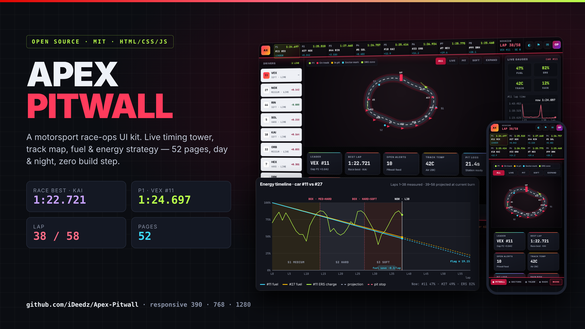</p>

<h1 align="center">Apex Pitwall</h1>

<p align="center">
  A motorsport race-operations UI kit with a live timing tower, track map, team radio and fuel/energy strategy.<br>
  52 pages · day &amp; night themes · plain HTML/CSS/JS · no build step.
</p>

<p align="center">
  <a href="LICENSE"></a>
  
  
  
</p>

---

## Screenshots

| Night | Day |
|---|---|
| 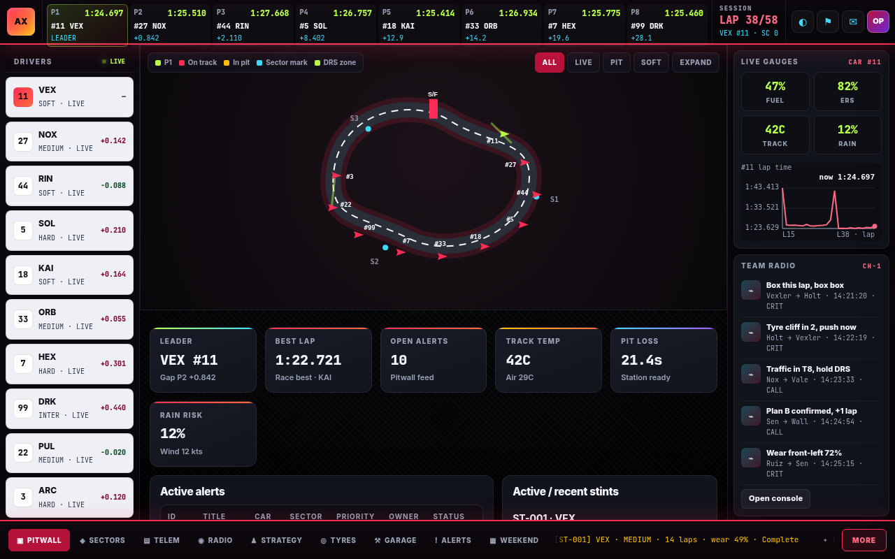 | 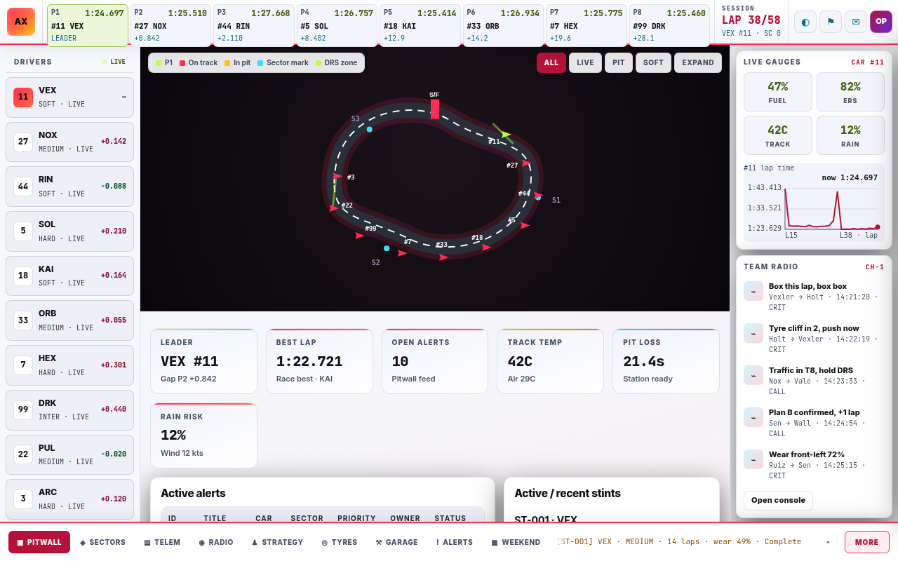 |
| 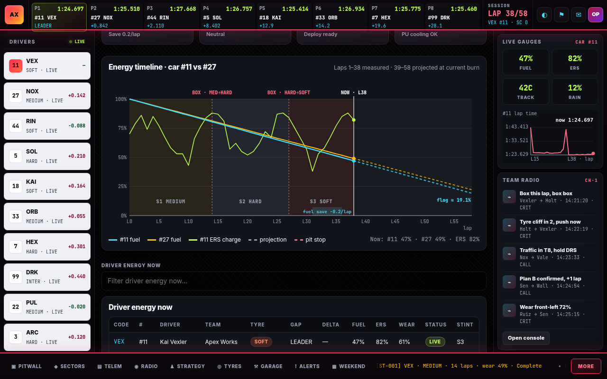 | 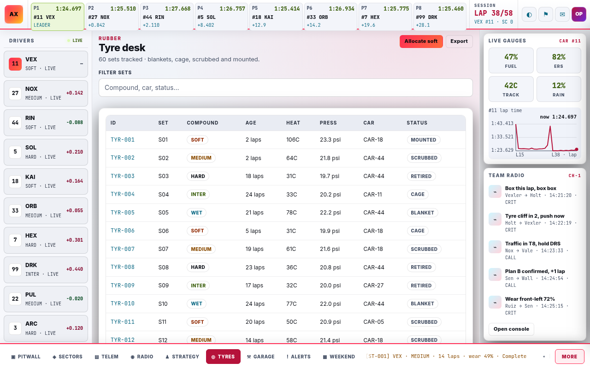 |
| 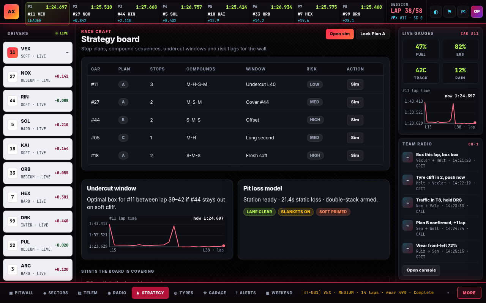 | 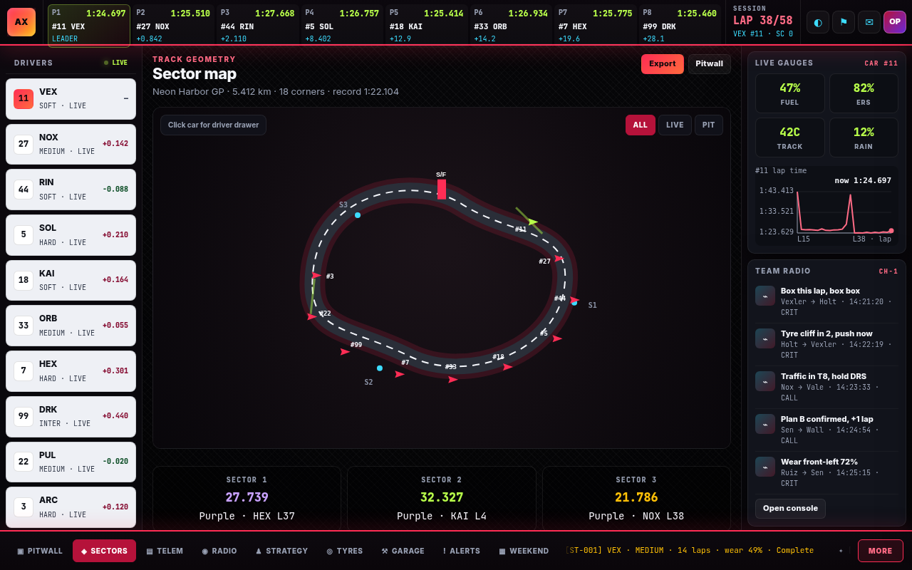 |

<p align="center">
  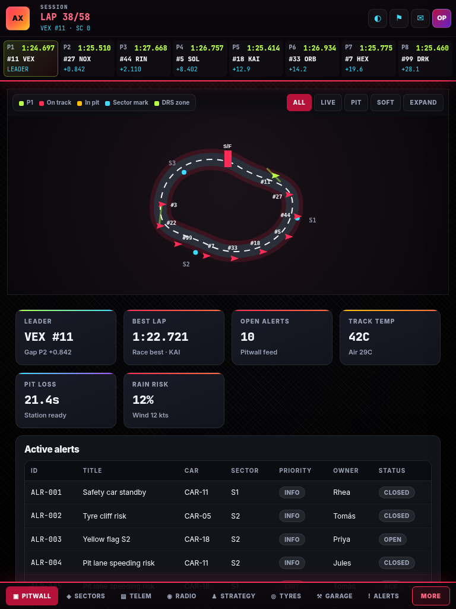
  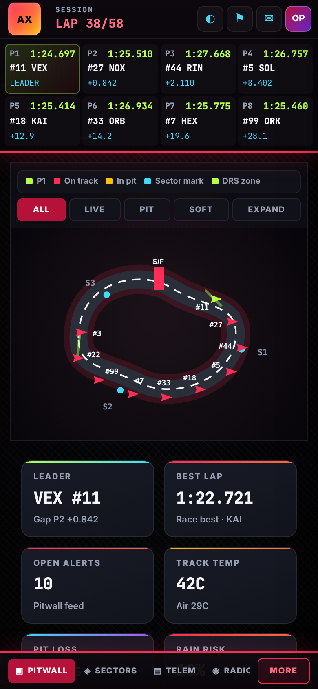
  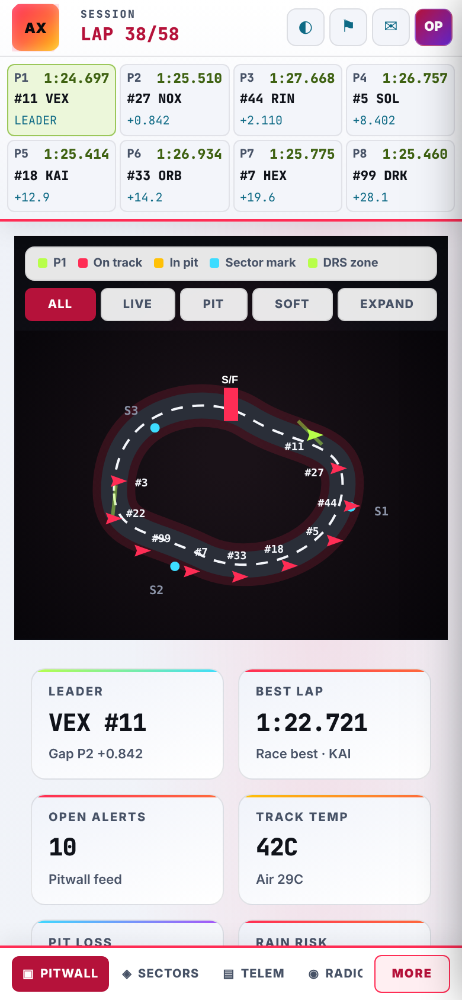
  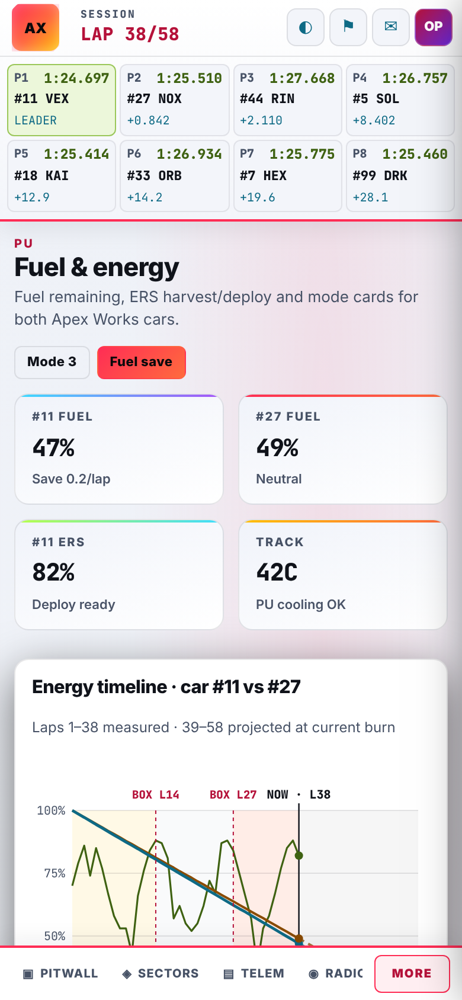
</p>

## Features

- **Pitwall layout instead of a SaaS sidebar.** The timing tower runs along the top, the driver stack sits on the left, the track canvas is in the centre, radio and strategy are on the right, and a stint/tyre ticker runs along the bottom.
- **Live track canvas.** Animated cars, sector marks, DRS zones, pit and filter states.
- **Fuel and energy timeline.** An SVG chart with axes, legend, stint bands, pit markers, a fuel-save window, a "now" marker and a projection to the flag.
- **Consistent demo data.** Every lap time equals the sum of its sectors, and the race best (1:22.721, KAI) is the fastest race lap on every page (only labelled qualifying and circuit-record times are quicker). `qa/audit.py` enforces it.
- **In-app navigation.** Only the content area swaps, behind a terminal-style loader. It uses `pushState` with back/forward support, keeps the driver-stack scroll position and re-initialises page scripts. It falls back to normal page loads on `file://`.
- **Day and night themes.** Text-safe accent tokens give all text at least 4.5:1 contrast in both themes.
- **Responsive at 390, 768 and 1280.** The full P1–P8 tower is shown at every width, with no horizontal scroll and every menu reachable.

## Quick start

```bash
git clone https://github.com/iDeedz/Apex-Pitwall.git
cd Apex-Pitwall
npx serve .            # or: python3 -m http.server 8940
```

Open `http://localhost:3000/login.html` (or the port your server prints) and sign in with the demo account **ops@apex.demo / demo**. You can also open `index.html` straight from disk. Everything works offline, and navigation falls back to full page loads.

## Project structure

```
├── *.html              52 pages (shared chrome, page-specific <main>)
├── css/
│   ├── variables.css   design tokens + text-safe "-t" accents (night/day)
│   ├── ...             base, layout, components
│   └── responsive.css  breakpoints, day-theme chrome, loader, energy chart
├── js/
│   ├── data.js         drivers, tower, stints, radio, strategy, alerts, …
│   ├── data-extra.js   lap table, telemetry samples, debrief notes
│   ├── track-canvas.js animated track map (ApexTrack)
│   ├── charts.js       sparklines + fuel/energy timeline (ApexCharts)
│   ├── spa.js          content-only navigation (ApexSPA)
│   └── app.js          chrome binders + per-page init (AX.initPage)
├── docs/               pages, data, theming, components, screenshots, cover
├── qa/                 contrast/layout/navigation checkers (maintainers)
└── tools/              data normaliser (keeps laps = Σ sectors)
```

## Customising

- **Theme:** see [docs/THEMING.md](docs/THEMING.md). Use the `--ax-*-t` tokens for text and the plain accents for fills.
- **Data:** see [docs/DATA.md](docs/DATA.md). Lap data is the single source of truth: after editing plans or driver records, run `python3 tools/derive.py` (regenerates the lap tape and every derived number and baked copy), then `python3 qa/audit.py`.
- **Pages:** see [docs/PAGES.md](docs/PAGES.md).
- **Adding a page:** copy any page, replace `<main>` and keep the chrome. The SPA swaps `main` automatically.

## Quality checks

```bash
npm install                      # installs puppeteer-core (devDependency); uses your local Chrome (CHROME=/path/to/chrome)
python3 -m http.server 8940 &    # or set BASE=http://127.0.0.1:<port>/
npm ci                           # or npm install
npm run qa                       # runs all six checks below
# node qa/check.js               # contrast (pixel-sampled), layout, dead links, JS errors
# node qa/spa.js                 # navigation, back/forward, file:// fallback
# node qa/labels.js              # track-canvas label overlap incl. S/F bar (sampled over time)
# node qa/sparks.js              # spark text collisions at 390/768/1280
# node qa/dupes.js               # repeated stat cards on any page
# python3 qa/audit.py            # data consistency, nothing faster than the race best
```

## Contributing

PRs are welcome. See [CONTRIBUTING.md](CONTRIBUTING.md) and the [Code of Conduct](CODE_OF_CONDUCT.md).

## License

[MIT](LICENSE) © 2026 Mr Deedz. All drivers, teams and telemetry are fictional demo data. This project is not affiliated with Formula 1 or any racing team.
